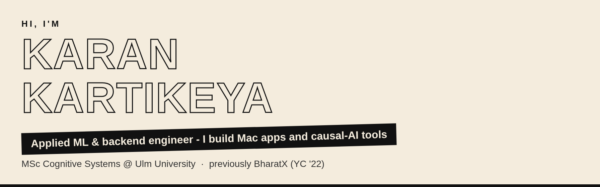
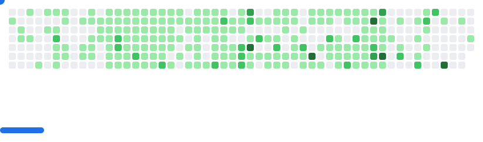

  

## Hi, I'm Karan 👋

Applied ML & backend engineer - I build Mac apps and causal-AI tools.
MSc Cognitive Systems @ Ulm University · previously BharatX (YC '22).

  

## 💻 My Mac apps

| 🖥️ [MacUno](https://macuno.viberank.co.in) | 👏 [ClapSnap](https://clapsnap.viberank.co.in) |
| --- | --- |
| Desktop transitions that follow your MacBook's lid. Close the lid and your desktop blurs, narrows in perspective and dims; open it and the effect reverses. | Launch your Mac workspace with a double clap or snap. Includes Air Mouse: move the cursor with your hand through the webcam. |
| **$4.50** one-time, no subscription | Pay what you want, **from €8** |

## 🔬 Open source

- 🧠 [Engram-Causal](https://github.com/karankartikeya/Engram-Causal) - Python library for causal reasoning and knowledge-graph experimentation
- 🐍 [PyLayer](https://github.com/karankartikeya/PyLayer) - local MCP server that grounds Claude Code in a project's real Python environment
- 🎤 [slide-coach](https://github.com/karankartikeya/slide-coach) - AI presentation coach with live feedback, audience questions and interview simulations
- 🌐 [karankartikeya.netlify.app](https://karankartikeya.netlify.app) - my portfolio site
- 🧩 FixUI *(private)* - Manifest V3 browser extension that reshapes any website through element fingerprinting

## 🤝 Connect

<picture>
  <source media="(prefers-color-scheme: dark)" srcset="images/breakout-dark.svg" />
  <source media="(prefers-color-scheme: light)" srcset="images/breakout-light.svg" />
  
</picture>
